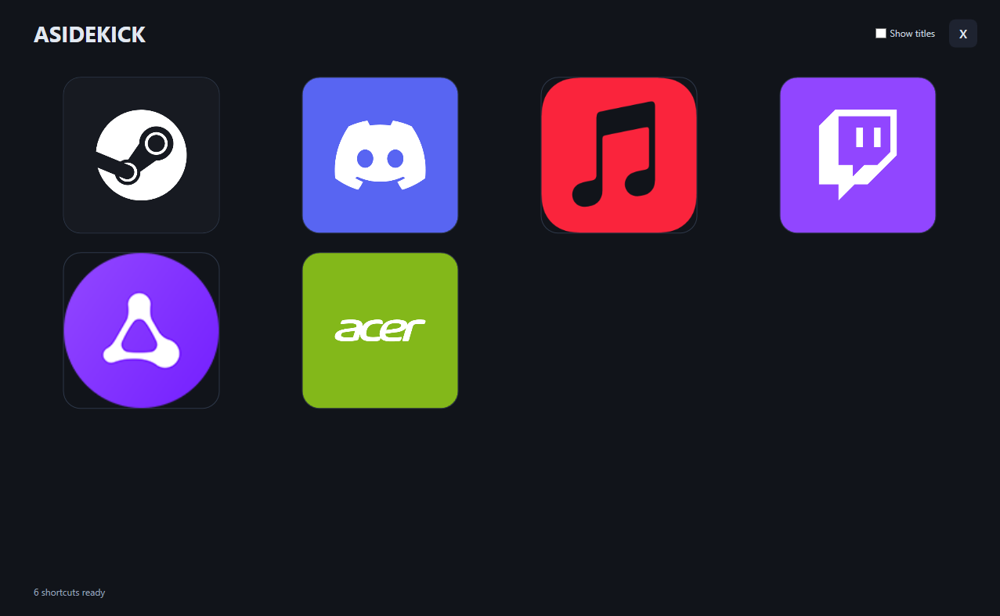
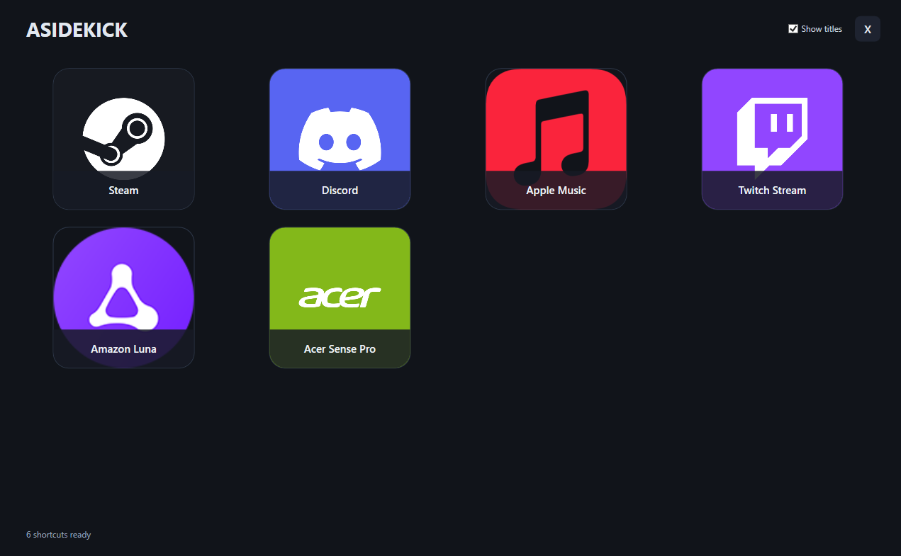

# ASidekick

[](LICENSE)


ASidekick is a lightweight, fullscreen shortcut launcher for a Windows secondary display. It gives you a dedicated place for one-click shortcuts to apps, games, websites and other targets whilst keeping your main display available for whatever you are doing.

Created by [Ali](https://github.com/citrocity)

## Why ASidekick?

Many second-screen tools are heavier than needed for a simple launcher. They can require separate host and client software, or focus on sending a phone or tablet display over Wifi or a LAN. ASidekick (Ali's Sidekick) takes a simpler approach. Windows drives the second display as a regular monitor, and ASidekick runs directly on it, no network streaming, companion client or host service.

## How it works

- Finds the first non-primary display reported by Windows and opens a fullscreen launcher there.
- Reads shortcut tiles from `shortcuts.json`.
- Launches each target using the Windows shell, so app links, URLs, and executable paths can be used.
- Supports custom tile images, arguments, and working directories.
- Can make a best-effort attempt to open a launched app on the primary display.

ASidekick does not create a virtual display or transmit video to another device. Windows must already recognise the connected display.

## Screenshots

<table>
  <tr>
    <td align="center">
      
      <br>Shortcut titles hidden
    </td>
    <td align="center">
      
      <br>Shortcut titles shown
    </td>
  </tr>
</table>

## Requirements

- Windows 10 or Windows 11.
- At least one secondary display enabled in **Settings > System > Display** (use **Extend these displays** if you want a separate desktop).
- To run a framework-dependent build: the **.NET 8 Desktop Runtime**.
- To build from source: the **.NET 8 SDK** with Windows desktop/WPF support.

## Getting started

1. Connect the secondary display and enable it in Windows Display settings.
2. Download and extract a release, or clone this repository.
3. Copy `ASidekickLauncher/shortcuts.example.json` to `ASidekickLauncher/shortcuts.json`.
4. Edit `shortcuts.json` to configure your shortcut tiles.
5. Run `ASidekick.exe`.

When running from source, create your local configuration first, then run:

```powershell
if (-not (Test-Path .\ASidekickLauncher\shortcuts.json)) {
    Copy-Item .\ASidekickLauncher\shortcuts.example.json .\ASidekickLauncher\shortcuts.json
}
dotnet run --project .\ASidekickLauncher\ASidekickLauncher.csproj
```

To build a Release version:

```powershell
dotnet build .\ASidekickLauncher\ASidekickLauncher.csproj -c Release
```

The built app and its copied `shortcuts.json` are in `ASidekickLauncher/bin/Release/net8.0-windows/`. Rebuild after changing the app's source code. If you only change shortcuts, update the `shortcuts.json` beside the built executable (or build again to copy the project configuration).

The app closes with a warning if Windows does not report a secondary display.

## Configure shortcuts

`shortcuts.json` must contain a JSON array. Each item can include:

| Property | Required | Description |
| --- | --- | --- |
| `Title` | Yes | Label shown on the tile (can be toggled on the app). |
| `TargetPath` | Yes | An executable path, URL, or registered application URI/protocol. |
| `ImagePath` | No | Tile image path. Relative paths are resolved from the folder containing `ASidekick.exe`. |
| `Arguments` | No | Arguments passed to the target. |
| `WorkingDirectory` | No | Working directory. Relative paths are resolved from the folder containing `ASidekick.exe`. |
| `ForceMainDisplay` | No | When `true`, ASidekick attempts to bring the primary desktop to the foreground before launching. This is best effort; the target app ultimately controls its window placement. |

See [`ASidekickLauncher/shortcuts.example.json`](ASidekickLauncher/shortcuts.example.json) for a complete example. Its targets are examples and may require the relevant apps to be installed. Keep `shortcuts.json` beside the executable and keep any referenced images at their configured paths. Copy the example file to `shortcuts.json` and customise it for your computer. The actual `shortcuts.json` is intentionally ignored by Git because it can contain personal paths, installed app IDs or private links.

## Display compatibility

ASidekick uses the displays Windows reports to the app; it is not tied to a particular monitor brand or connection type. A Corsair XENEON display or a similar portable/secondary monitor should work if Windows recognises it as a separate, enabled display (for example, over a supported USB-C display connection or HDMI) and it is configured as an extended display. Compatibility with a specific model has not been independently tested.

ASidekick does not install display drivers, turn a USB-only panel into a monitor, or provide video-over-network functionality. Touch input, if a display offers it, is handled by Windows and the display hardware rather than by ASidekick.

## Licence

The ASidekick source code is licenced under the [Apache License, Version 2.0](LICENSE). It permits use, modification and redistribution subject to its terms, including retaining the licence and applicable notices. The licence is provided **without warranties**; see the full text in `LICENSE`.

Third-party icons and brand marks are not relicenced under Apache-2.0. Simple Icons artwork is identified as CC0 in the [asset attribution file](ASidekickLauncher/Assets/ATTRIBUTION.txt); product names, logos and other third-party artwork remain subject to their owners' rights and applicable terms. Review that attribution file before redistributing the included assets.
